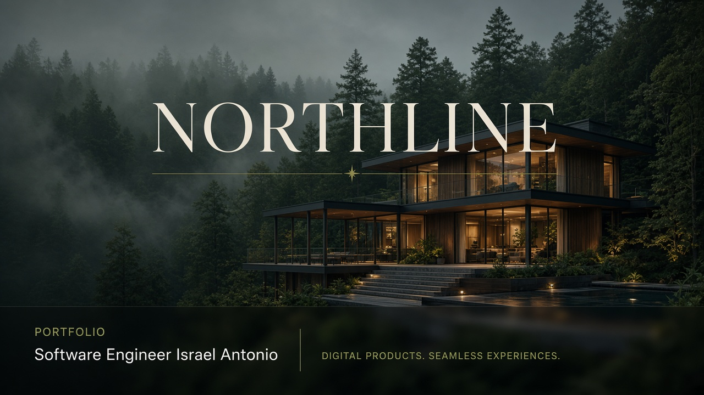
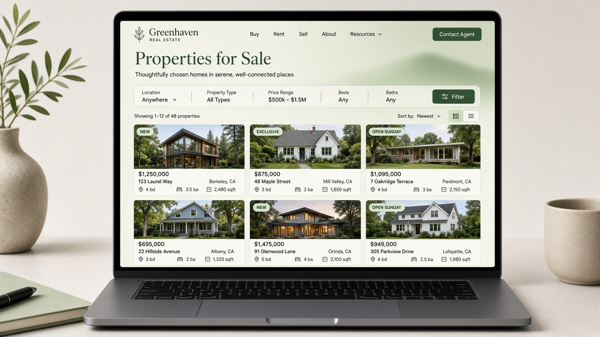
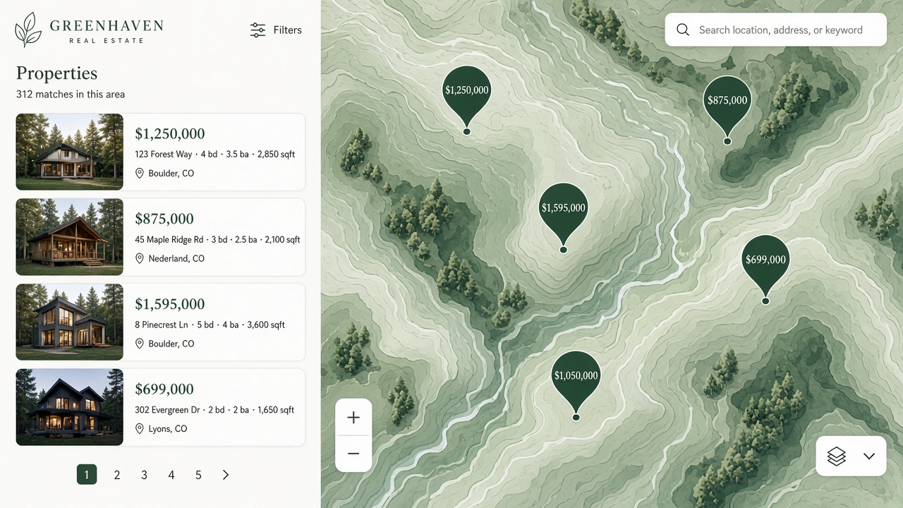
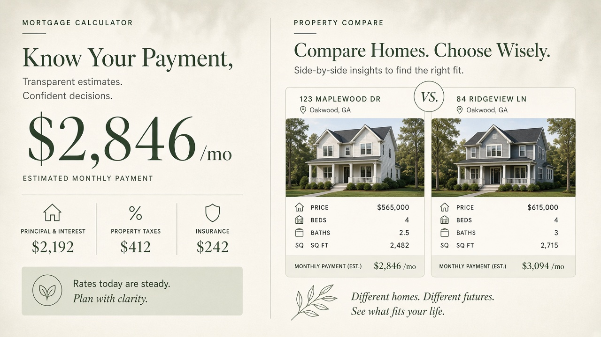

# Israel Antonio

**Senior Software Engineer · Frontend / Full-Stack**  
React · TypeScript · Vite · Product UI · Clean Architecture


I design and ship polished web products with strong UX, maintainable architecture, and production-ready engineering practices. This case study highlights **Northline Realty** — a complete real-estate platform frontend built as a portfolio demonstration of pro-grade listing search, discovery, and buyer tooling.

---

## Featured project — Northline Realty



| | |
| --- | --- |
| **Role** | Product engineer (solo) — UX, UI system, architecture, implementation |
| **Type** | Real-estate marketplace / brokerage frontend |
| **Stack** | React 19, Vite, TypeScript, React Router |
| **Data** | Fully mocked listings, agents, neighborhoods, and insights |
| **Status** | Demo-ready SPA |

### Problem

Professional real-estate platforms must do more than show houses. Buyers need fast search, map context, comparison, payment modeling, trusted agent profiles, and a personal workspace — without friction. Most demos stop at a card grid. Northline was built to feel like a **complete product surface**.

### Goal

Ship a cohesive, brand-forward SPA that demonstrates:

1. End-to-end discovery (search → detail → inquiry)
2. Spatial browsing (map + pins)
3. Decision tools (favorites, compare, mortgage calculator)
4. Trust content (agents, neighborhoods, market insights)
5. Account flows (auth + buyer dashboard)

---

## Product walkthrough

### 1. Listings discovery



- Advanced filters: status, type, city, beds, sort
- Featured inventory on the homepage with expressive hero search
- Detail pages with gallery, specs, features, similar homes, and inquiry form

### 2. Map search



- Synchronized list + pin canvas
- Status filtering for sale / rent
- Active listing preview with deep link into detail

### 3. Decision & finance tools



- Favorites and compare (up to 4 homes) persisted in `localStorage`
- Mortgage calculator with price, down payment, rate, term, tax, and HOA
- Inline payment estimate on sale listings

### 4. Trust & content

- Agent directory and profile pages with specialties and active inventory
- Neighborhood guides with walk / transit / school scores
- Insights blog for market education
- Contact + mock auth + buyer dashboard

---

## Architecture highlights

```text
src/
  pages/          Route-level screens
  components/     Layout, property, map, mortgage, search UI
  context/        Favorites, compare, mock auth (localStorage)
  data/           Typed mock domain data
  lib/            Filtering + formatting utilities
  types/          Shared domain models
```

**Key engineering choices**

- **Typed domain model** for properties, agents, neighborhoods, posts, and filters
- **Pure filter pipeline** (`filterProperties`) for predictable listing queries
- **Provider-based client state** for favorites / compare / session without a backend
- **Composable UI** — cards, gallery, inquiry, calculator reused across routes
- **Design system via CSS variables** — brand, type, spacing, motion

---

## Design direction

Northline uses a calm architectural identity:

- **Brand:** Northline
- **Palette:** forest green, charcoal, soft paper sage
- **Type:** Fraunces (display) + Manrope (UI)
- **Motion:** restrained hero zoom + staggered entrance
- **Layout principle:** one job per section; brand-led first viewport

The UI intentionally avoids generic “AI purple” and heavy card clutter so the product feels editorial and premium.

---

## Feature checklist

- [x] Home hero + search
- [x] Listings index + filters
- [x] Listing detail (gallery, inquiry, payment estimate)
- [x] Map search
- [x] Favorites
- [x] Compare table
- [x] Mortgage calculator
- [x] Agents + profiles
- [x] Neighborhoods + detail
- [x] Blog + article pages
- [x] Login / register (mock)
- [x] Buyer dashboard
- [x] Contact form
- [x] Responsive layout

---

## Impact (demo outcomes)

| Outcome | Detail |
| --- | --- |
| Full product breadth | 15+ routed experiences in one SPA |
| Realistic inventory | 12 properties across sale / rent / pending / sold |
| Decision support | Compare + favorites + payment modeling |
| Portfolio clarity | Strong brand, coherent UX, readable architecture |

---

## Run the project

```bash
npm install
npm run dev
```

Production build:

```bash
npm run build
npm run preview
```

---

## About Israel Antonio

I care about shipping interfaces that feel intentional: clear information hierarchy, durable component structure, and TypeScript-first models. Whether leading delivery or building end-to-end demos, I focus on **DX, product completeness, and visual craft**.

**Open to:** remote frontend / full-stack roles, product engineering, and technical leadership on web platforms.

---

## Assets in this folder

| File | Use |
| --- | --- |
| `images/israel-antonio.jpg` | Personal brand portrait |
| `images/cover-northline.jpg` | Project cover / hero |
| `images/ui-listings.jpg` | Listings UI mockup |
| `images/feature-map.jpg` | Map search feature visual |
| `images/feature-tools.jpg` | Mortgage + compare feature visual |

---

*Northline Realty — portfolio case study by Israel Antonio · React + Vite + TypeScript*
